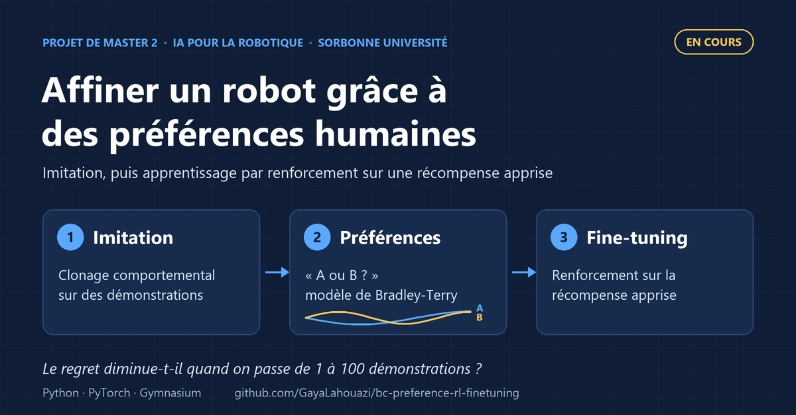

# Fine-tuning behavioural cloning policies with preference-based RL



> **Status: work in progress.** The first building blocks are implemented and tested (see [What is in the repository](#what-is-in-the-repository)). The BRIDGE algorithm, the experiments and the results are not here yet.

Course project for **IAR** (Intelligence Artificielle pour la Robotique, AI for robotics), M2 AI2D, Sorbonne Université, 2026–2027. Carried out in a team of two, supervised by Silvia Tulli (ISIR).

It studies the approach of:

> M. Macuglia, P. Friedrich, G. Ramponi. *Fine-tuning Behavioral Cloning Policies with Preference-Based Reinforcement Learning.* ICLR 2026. [arXiv:2509.26605](https://arxiv.org/abs/2509.26605)

## The paper in brief

Robots are often taught by imitation: a policy is trained by behavioural cloning (BC) on expert demonstrations that carry no reward. BC gives a safe starting point, but it is limited by the quality and coverage of the demonstrations. Writing a reward function to improve it further is hard. Instead, a human can compare pairs of trajectories and say which one is better.

The paper proposes a two-stage framework:

1. **Offline:** learn an initial policy from reward-free expert demonstrations.
2. **Online:** fine-tune it with preference-based RL, from pairwise trajectory comparisons.

Their algorithm, **BRIDGE**, uses the demonstrations to build a confidence set over policies, which constrains the online preference learning. The central theoretical claim is a regret bound that shrinks with the number of offline demonstrations. The authors evaluate it on two discrete environments (StarMDP, Gridworld) and two continuous MuJoCo ones (Reacher, Ant), against offline BC alone and online preference-based RL alone.

## Objective of this project

Test that claim empirically:

- Vary the size of the offline dataset (e.g. 1, 5, 20 and 100 expert trajectories).
- Run on simulated environments (Gymnasium / MuJoCo, as in the paper).
- Replace the human with a **synthetic teacher** that prefers the trajectory with the higher true return.
- Measure the regret and the number of preference queries needed to reach a target performance.
- Check whether the empirical trend matches the shape predicted by the bound.

## What is in the repository

| Module | Role | State |
|---|---|---|
| `prefrl/trajectories.py` | Trajectory container, seeded rollouts in a Gymnasium environment, demonstration subsets of a given size | done, tested |
| `prefrl/teacher.py` | Synthetic preference teacher: perfectly rational, or noisy following the Bradley-Terry model; counts the queries | done, tested |
| `prefrl/reward_model.py` | Reward model `r(s, a)` fitted on pairwise comparisons (Bradley-Terry likelihood), ranking accuracy | done, tested |
| `prefrl/bc.py` | Offline stage: behavioural cloning of a continuous-action policy | done, tested |
| BRIDGE (confidence set + constrained online stage) | | to do |
| Baselines, regret measurement, experiments over seeds | | to do |

The tests check each block on small controlled problems (a hidden linear reward, a linear expert, `Pendulum-v1` rollouts). They say that the blocks behave as intended, not anything about the paper's claim.

```bash
pip install -r requirements.txt
```

```bash
pytest
```

## Plan

- [x] Repository, project question and plan
- [x] Trajectory tools and demonstration subsets
- [x] Synthetic preference teacher (prefers the higher-return trajectory)
- [x] Building blocks: behavioural cloning, reward model learned from preferences
- [ ] Write down the bound and how it depends on the number of demonstrations
- [ ] Environments and expert policies; demonstration datasets of 1, 5, 20 and 100 trajectories
- [ ] BRIDGE; baselines: BC alone, online preference-based RL alone
- [ ] Metrics: cumulative regret, number of queries to reach a target return; several seeds
- [ ] Compare the empirical curves with the predicted shape of the bound
- [ ] Report and results

## Stack

Python, PyTorch, Gymnasium (MuJoCo for the continuous-control experiments).

## Author

Gaya Lahouazi, M2 AI2D (Sorbonne Université).
